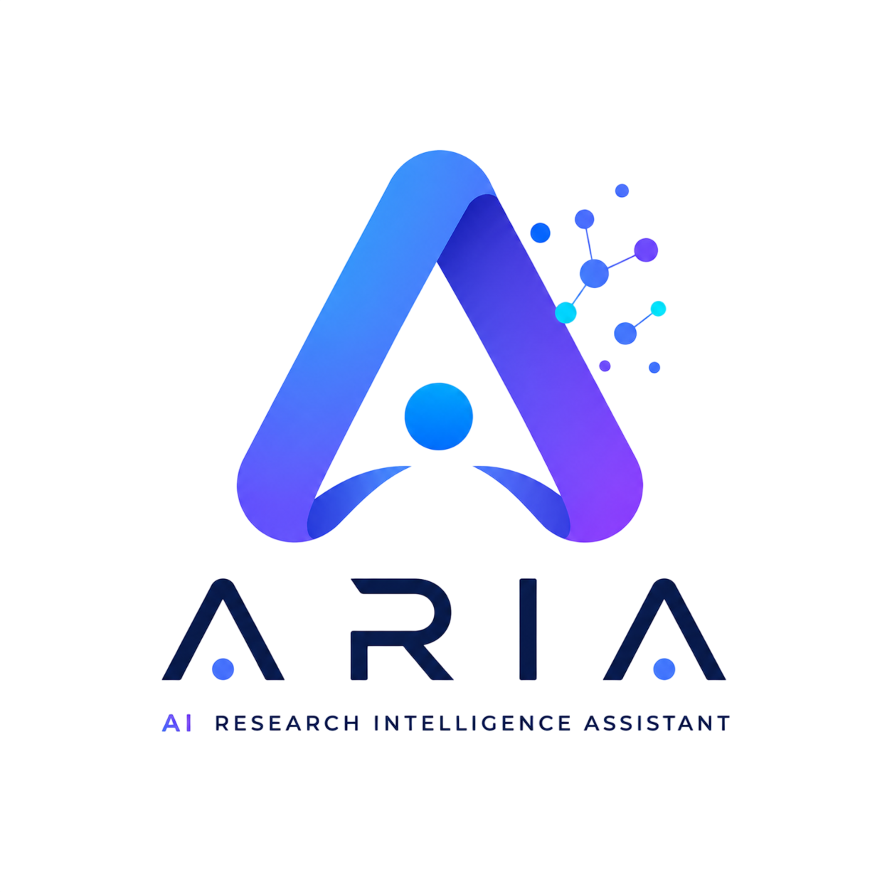
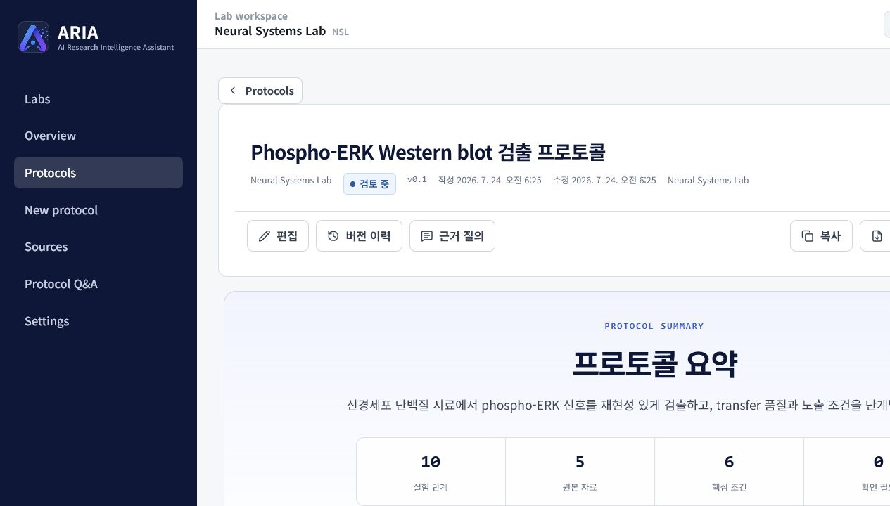
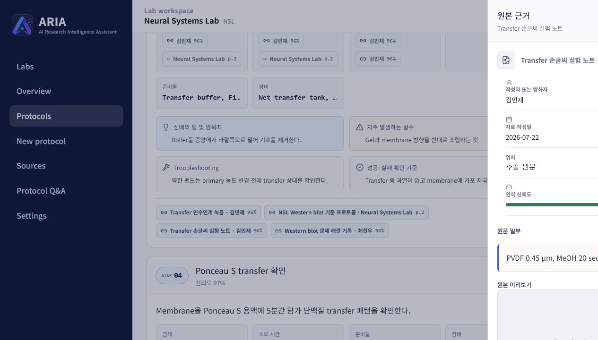
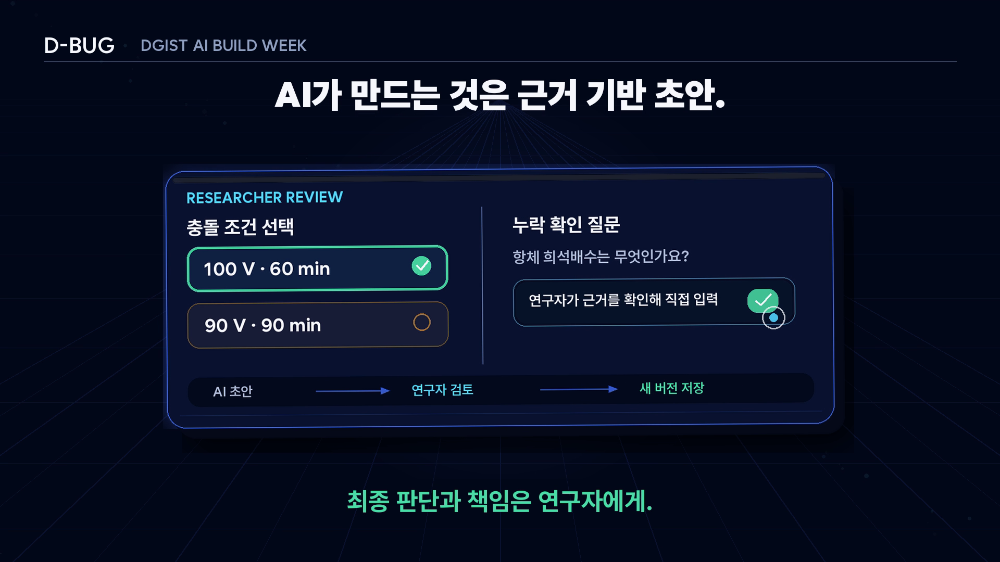
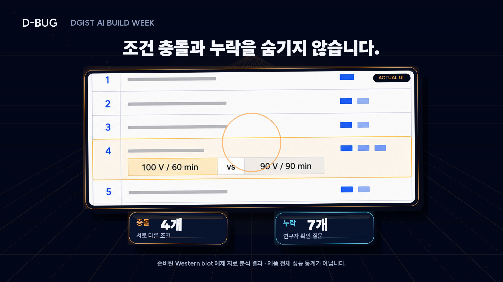
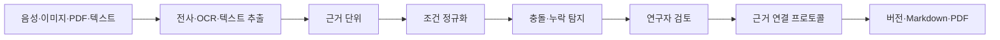

<p align="center">
  
</p>

<h1 align="center">ARIA</h1>

<p align="center">
  <strong>AI Research Intelligence Assistant</strong><br />
  음성, 손글씨, 메모와 기존 문서를 원본 근거가 연결된 검토용 실험 프로토콜 초안으로 정리합니다.
</p>

<p align="center">
  <a href="https://joonseok331park.github.io/AI_Research_Intelligence_Assistant/">웹 앱</a>
  ·
  <a href="./PRIVACY.md">개인정보 안내</a>
  ·
  <a href="./SECURITY.md">보안 정책</a>
</p>

## 우리가 해결하려던 문제

실험 노하우는 SOP 한 문서에만 있지 않습니다. 인수인계 음성, 손글씨 메모,
오래된 PDF와 troubleshooting 기록에 흩어져 있습니다. 이를 다시 정리하는
동안 출처가 빠지고, 서로 다른 조건이 섞이거나 빈칸을 추정으로 채우게 됩니다.

ARIA는 AI가 답을 확정하는 대신 자료를 구조화하고 판단은 연구자에게
남깁니다. 서로 다른 수치와 조건은 충돌로 표시하고, 자료에 없는 내용은
질문으로 돌려보냅니다. 생성된 초안에는 파일명, PDF 페이지, 인용문과
음성 구간이 함께 남습니다.

이 저장소는 D-BUG 팀의 2026-07-24 작업본을 따로 보존한 독립 사본입니다.
GitHub Fork가 아니며 다른 저장소와 자동으로 동기화되지 않습니다. 기준점은
[`UPSTREAM.md`](./UPSTREAM.md)에 기록했습니다.

## 프로젝트 맥락과 기여

ARIA는 **D-BUG** 팀이 2026 DGIST AI Build Week에서 만든 팀 프로젝트입니다.
12개 참가팀 가운데 우수상 수상 3개 팀 중 하나로 선정되었습니다.

박준석은 아이디어와 워크플로를 공동 설계하고, 주요 프로토타입 구현,
Next.js·TypeScript와 Gemini 통합, 디버깅과 합성 데모 검증을 맡았습니다.
프로토타입 개발에는 AI 개발 도구도 활용했으며, 통합 결과와 공개 배포본은
직접 점검했습니다. 이 저장소는 팀 프로젝트의 독립 공개 사본이며 개인의
단독 저작물로 설명하지 않습니다.

## 화면과 데모 요약

아래 화면의 연구실, 연구자, 날짜, 문서번호와 실험 결과는 모두 합성
자료입니다.

### 프로토콜 요약



### 원본 근거 확인



### 발표용 충돌 검토 요약



### 발표용 충돌·누락 요약



## 현재 들어 있는 기능

- 음성, 이미지, PDF, TXT, Markdown 파일을 한 번에 업로드
- Gemini를 이용한 전사, OCR, PDF 텍스트 추출과 단계 분류
- 시간·온도·농도·속도·단위 정규화
- 서로 다른 조건의 충돌 탐지와 Western blot 데모용 7개 필수 필드 누락 질문 생성
- 연구자 답변을 근거로 저장하고 새 버전에 반영
- 프로토콜 요약, 준비물, 장비 설정, 단계별 절차와 troubleshooting 구성
- 파일·페이지·인용문·타임스탬프까지 이어지는 근거 추적
- Markdown 다운로드와 인쇄용 PDF 출력
- 연구실 디렉터리와 연구실별 프로토콜 관리

처리 흐름은 다음과 같습니다.



## 예제 자료로 확인하기

Overview의 `예제 모음집 다운로드`를 누르면 합성 전사문, 손글씨 이미지,
PDF, TXT와 Markdown 파일을 받을 수 있습니다.

1. ZIP을 내려받아 압축을 풉니다.
2. `New protocol`에서 예제 파일 다섯 개를 선택합니다.
3. 분석이 끝나면 원본 근거와 충돌·누락 항목을 확인합니다.
4. 필요한 답을 입력하고 프로토콜을 저장합니다.
5. Markdown으로 내려받거나 인쇄 메뉴에서 PDF로 저장합니다.

현재 포함된 합성 Western blot 5개 파일 데모에서는 충돌 4건과 누락 질문
7건이 재현됩니다. 이는 데모 규칙의 고정 결과이며 제품 전체의 정확도나
성능 통계가 아닙니다.

공개 저장소에는 사람 목소리가 담긴 녹음 파일을 넣지 않았습니다. 파일별
제작 방식과 공개 범위는
[`demo-files/PROVENANCE.md`](./demo-files/PROVENANCE.md)에 적어 두었습니다.

## 로컬 실행

필요한 환경:

- Node.js 22.13 이상
- pnpm 11.9.0

```bash
pnpm install --frozen-lockfile
pnpm dev
```

`http://localhost:3000`을 열고 `Settings`에서 본인의 Gemini API 키를
입력하면 됩니다. 키는 저장소나 배포 파일에 들어 있지 않습니다.

검증은 아래 명령으로 실행합니다.

```bash
pnpm run lint
pnpm run typecheck
pnpm test
pnpm run validate:public
pnpm run build
```

`main` 브랜치에 반영되면 GitHub Actions가 같은 정적 검사를 거친 뒤
GitHub Pages용 사이트를 빌드하고 배포합니다.

## 데이터는 어디로 가나

ARIA는 별도 백엔드 없이 동작하는 정적 웹 앱입니다. Gemini 요청은
브라우저에서 Google로 직접 전송됩니다. 프로토콜과 자료 메타데이터뿐 아니라
원본 미리보기와 복원을 위한 업로드 파일도 Blob 형태로 해당 브라우저의
IndexedDB에 저장될 수 있습니다. 앱의 초기화 기능이나 브라우저의 사이트
데이터 삭제를 실행하면 함께 삭제되며 복구할 수 없습니다. 중앙 백업이나
기기 간 동기화는 제공하지 않습니다.

API 키는 현재 탭의 메모리에만 두며 새로고침하거나 탭을 닫으면 사라집니다.
업로드 자료가 Google Gemini로 전송되므로 미공개 연구결과, 개인정보,
환자·피험자 정보나 기관 보안자료는 넣지 마세요. 자세한 내용은
[`PRIVACY.md`](./PRIVACY.md)에서 확인할 수 있습니다.

## 기술 구성

| 영역 | 사용 기술 |
| --- | --- |
| 웹 | Next.js 16, React 19, TypeScript 5 |
| 화면 | Tailwind CSS 4, Lucide React |
| 상태·저장 | Zustand, Dexie, IndexedDB |
| AI | Google Gemini, `@google/genai` |
| 문서 처리 | PDF.js, Zod |
| 테스트·배포 | Vitest, GitHub Actions, GitHub Pages |

## 아직 하지 않는 것

- 방문자·연구원 전환은 화면 모드일 뿐 실제 인증이나 권한 통제가 아닙니다.
- 다중 사용자 협업, 중앙 백업과 조직 단위 감사 로그는 제공하지 않습니다.
- ARIA는 ELN이나 LIMS를 대신하지 않습니다.
- AI가 만든 조건은 연구실 안전 규정과 책임 연구자의 검토를 대체하지
  않습니다.
- 현재의 결정론적 누락 검출은 합성 Western blot 데모의 7개 필수 필드에
  맞춘 규칙입니다.

## 권리와 출처

코드와 프로젝트 자산은 포트폴리오 열람용으로 공개합니다. 별도 서면 허락
없이 복제·수정·배포할 수 없습니다. 세부 범위는 [`LICENSE`](./LICENSE)와
[`ASSET-NOTICE.md`](./ASSET-NOTICE.md)를 확인하세요. 오픈소스 패키지는 각
패키지의 라이선스를 따르며 목록은
[`THIRD-PARTY-NOTICES.md`](./THIRD-PARTY-NOTICES.md)에 정리했습니다.
